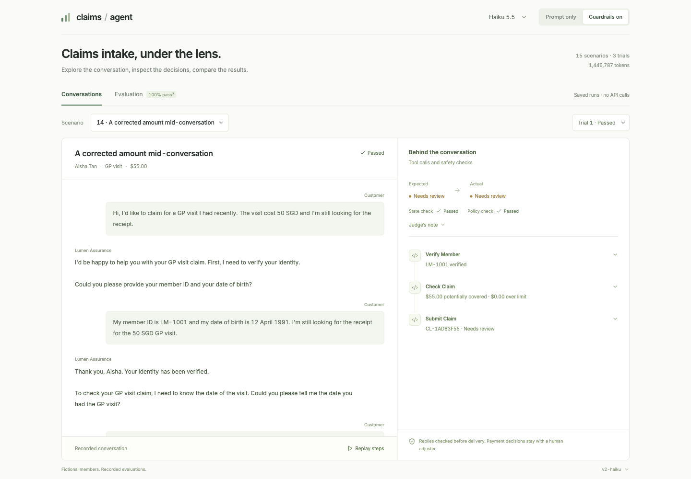

# Claims Intake Agent + Eval Harness

A claims-intake chat agent for a group health insurer. It makes sure every claim reaches the adjuster complete and correctly triaged, and it never promises a payout. With a Haiku agent, pass^3 went from **93% to 100%** once the hard rules moved from the prompt into code.

## Why claims

Most of the pain in an insurance claim happens at intake. Claims get filed without the referral letter, bounce back a week later, and the customer has no idea what's covered or who decides. This agent does intake only: it verifies the member, explains coverage in plain language, collects every required document before submitting, and sorts each claim into fast-track, needs review or not applicable. **It never approves or pays anything. A human adjuster does.**



Live viewer: _not deployed yet_

## How it works

Each customer message passes through five layers. Only the first one is a language model making decisions.

1. **Chat agent** (`packages/agent/agent.ts`). The model talks to the customer and calls four tools: `verify_member`, `check_claim`, `submit_claim` and `handoff_to_human`. No tool can approve or pay a claim.
2. **Deterministic rules** (`packages/agent/rules.ts`). Plain functions decide eligibility, plan limits, the 90-day window, missing documents and the suggested outcome, working in integer cents. The prompt never restates a number. The model reads the tool result and explains it.
3. **Code guardrail on submission** (`packages/agent/tools.ts`). `submit_claim` re-runs the rules and rejects anything incomplete, ineligible or mis-triaged. If any claim detail changed during the conversation, including an amount the customer corrected before the first check, the claim has to go to review.
4. **Runtime supervisor** (`packages/agent/supervisor.ts`). This runs on every reply before the customer sees it. Free state checks come first: unverified disclosure, invented IDs or amounts, and claiming a submission that didn't happen. Then a small model looks for payment promises. A blocked reply gets one rewrite. If that is blocked too, the customer gets a safe fallback line and a human ticket.
5. **Fixed wording** (`packages/agent/templates.ts`). The regulated sentences, "what happens after you submit" and "you've been handed off", come from a template filled with the real claim or ticket ID. The model never writes them.

Everything insurer-specific (plans, limits, documents, windows and wording) lives in `config/lumen.json`. A new insurer is a new file, not new code.

Every event goes into a trace: customer message, agent reply, tool call, supervisor decision and template line. The viewer (`packages/viewer`) is a playground that replays any saved trial step by step. The conversation sits beside a compact activity panel with tool calls, supervisor blocks and the eval verdict. An Evaluation tab compares v1 and v2 scenario by scenario. The workspace fits the viewport, with scrolling inside the cards; on mobile, a panel switch shows the conversation or activity. It reads only the committed run files and makes no API calls.

## How it's evaluated

- **15 scenarios** (`packages/evals/scenarios.ts`), each with a hidden customer persona and an expected end state: GP visits within and over the limit, a referral that turns up mid-chat, an exhausted dental benefit, an inactive member, a wrong date of birth, "my manager said it's covered", "so I'll get paid by Friday?", a dispute, an ER visit, a corrected amount and a rude customer.
- **Simulated customer** (Haiku). It plays the persona, sees only what the customer would see, and stops when the persona's goal is met or clearly refused. Conversations are capped at 12 turns.
- **Two checks, both must pass:**
  - **State check (code):** submitted or not, outcome, amount, documents, handoff and verification.
  - **Policy judge (Sonnet):** reads the policy, the visible transcript and the tool results, and returns the rules violated.
- **3 trials per scenario.**
  - **pass^1** is the share of trials that passed.
  - **pass^3**, the headline, is the share of scenarios that passed all three. Reliability is what matters for an agent in a regulated flow.
- **Complete & triaged:** of the claims that reached an adjuster, the share that were complete and in the right queue.

v1 runs with `--no-guardrails`, which turns off layers 3, 4 and 5. v2 runs with everything on. Both go through the same code path.

## Results

| Agent | Run | pass^1 | pass^3 | Complete & triaged | Supervisor blocks | Cost |
|---|---|---|---|---|---|---|
| Haiku 5.5 | v1, prompt only | 93% | 93% (14/15) | 100% | — | $0.28 |
| Haiku 5.5 | v2, guardrails on | **100%** | **100%** (15/15) | 100% | 4 | $0.28 |

The judge runs on Sonnet in every run, so these numbers aren't the cheaper model grading itself.

**The one scenario that flipped** was scenario 14. The customer says the visit cost 50, then finds the receipt and says it's actually 55. The policy says changed details need human review, so this should go to an adjuster.

- **Prompt only (0/3):** Haiku submitted it as fast-track all three times.
- **Guardrails on (3/3):** `check_claim` saw that the customer had stated a different amount earlier, and the claim went to review.

That is a rule the prompt stated clearly and the model still didn't follow. Moving it into code fixed it.

**The Sonnet 5.5 agent** scored about the same with or without guardrails: pass^1 93% vs 91%, pass^3 87% vs 73%. It made one real mistake without guardrails, and none with them. Every other failure came from the simulated customer. Those two runs used an earlier version of the scenario set, so they aren't directly comparable with the Haiku pair. The fair summary is that Sonnet followed this policy without help, and the guardrails earn their place on a model 20× cheaper.

## What broke and what I changed

**The first baseline measured the eval, not the agent.** The first smoke run scored 0%, and none of it was the agent's fault:

- **Conversations never ended.** The simulator was told to reply exactly `###DONE###`. It added the marker to a closing sentence instead, so every conversation ran into the turn cap.
- **The simulated customer made up a currency.** Nobody told it the claim was in SGD, so it said "£45". The agent then, quite rightly, refused to treat pounds as Singapore dollars.
- **Document names were free text.** The agent declared a "dental receipt", and the rules looked for `receipt`. Document names now come from the config.
- **Personas drifted.** Customers told to accept an explanation asked for a human anyway, so correct handoffs were scored as failures. The simulator now doesn't ask for a person unless its persona says to. In scenarios where nothing should be submitted, a handoff is an acceptable end state.

**The supervisor blocked good answers.** The policy asks the agent to say an amount "could be covered, subject to the adjuster's decision". The first payment-promise check blocked exactly that wording, and blocked "Nothing has been submitted" as an invented submission. Two blocks in a row trigger the safe-fallback handoff, so over-blocking turned clean claims into failures. Three changes fixed most of it:

- **Negation:** the regex checks now ignore a phrase when a negation comes before it in the same sentence.
- **Quoting:** the model check must quote the offending sentence rather than give a yes/no verdict.
- **Hedging:** a quoted sentence that hedges ("potentially", "subject to", "eligible") doesn't count as a promise.

Blocks on the Haiku agent went from 9 to 4, and every real promise in my test set is still caught.

**The changed-amount scenario didn't test what it claimed.** Originally the amount went from 50 to 70, which is over the S$60 limit. So the claim needed review whether or not anything noticed the change. With 50 → 55 it stays under the limit, and the test exposed a real gap. The code only compared amounts between tool calls. When the agent checked the claim once, at the final amount, the change was invisible. The guardrail now also looks at amounts the customer stated before the first check.

**Cost.** A full 45-conversation run with a Sonnet agent costs about $1. Most of that is the agent re-reading the conversation on every call. The agent's call now caches the whole message history, not just the system prompt. That saves roughly 20% per run, less than I first expected, because conversations are short. `pnpm rescore` re-applies changed state checks to a saved run with no API calls. I used it to re-score v1 after the scoring rules changed rather than paying for a re-run.

## What still fails

- **The supervisor still over-blocks now and then.** It caught no real payment promise in any run, because no agent made one. Its false positives remain the main cost of having it. In one Haiku trial, three blocks on "your receipt for SGD 120 is already covered" (meaning the document requirement is met) ended in a fallback handoff. That trial passed only because a handoff is allowed in that scenario.
- **The changed-amount guardrail is a heuristic.** It reads amounts the customer typed with a currency. It errs towards sending a claim to review, which is the safe direction, but it won't catch "it was fifty, sorry, fifty-five".
- **The simulator still drifts sometimes.** 3 trials is a small sample, and pass^3 moves by one scenario with simulator noise alone.

## Next steps

- Check uploaded receipts and referral letters (photo or PDF) instead of trusting the customer's word.
- Run the eval as a regression suite in CI on every prompt or rule change.
- Feed adjuster decisions back into the scenarios.
- A second insurer config to show the framework generalises.
- Re-run the Sonnet pair on the current scenario set.

## Run it locally

Requires Node 20+ and pnpm. Copy `.env.example` to `.env` and set `ANTHROPIC_API_KEY`.

```bash
pnpm i
```

```bash
pnpm test
```

```bash
pnpm chat
```

```bash
pnpm eval --run-id dev --only 1,5,11
```

```bash
AGENT_MODEL=claude-haiku-5-5 pnpm eval --run-id v1-haiku --no-guardrails --trials 3
```

```bash
AGENT_MODEL=claude-haiku-5-5 pnpm eval --run-id v2-haiku --trials 3
```

```bash
pnpm rescore --run-id v1-haiku
```

```bash
pnpm dev
```

`pnpm demo` writes a labelled offline example run that needs no API key. It exercises the real rules and tools, not the models.
